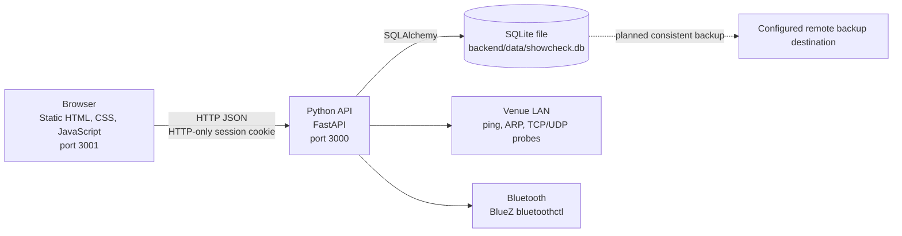

# ShowCheck Software Requirements Specification

| | |
|---|---|
| **Product** | ShowCheck, pre-show readiness verification for live productions |
| **Version** | 2.0 |
| **Date** | 12 November 2026 |
| **Status** | MVP architecture and progress update |
| **Supersedes** | SRS version 1.0 in `documentation/SRS.md` |

This revision reflects the implemented Python and SQLite architecture, the current MVP, and the next planned work. Requirement status describes the repository state at the date above; planned requirements are not claims about existing behavior.

## 1. Purpose and Scope

ShowCheck helps a live-event crew compare equipment assigned to a production against an approved baseline, identify exceptions, and record incidents. The system is intended to run on a Linux computer at the venue and be accessed by users on the same local network.

The MVP includes role-based access, LAN and Bluetooth discovery, manual device registration, baselines, pre-show checks, status dashboards, a dependency map, incident management, and user administration. Device discovery identifies supported devices and reachability; it does not generally read live configuration values from vendor equipment.

Out of scope for the current MVP are multi-venue tenancy, cloud-hosted application services, mobile-native applications, and RF spectrum scanning without additional receiver hardware.

## 2. Current Architecture

- **Frontend:** static HTML, CSS, and JavaScript in `frontend/`; no build step or frontend package manager is required. The browser calls the API at the same host on port 3000.
- **API:** FastAPI application in `backend/app/main.py`; SQLAlchemy models and database setup live in `backend/app/models.py` and `backend/app/database.py`.
- **Database:** local SQLite file on the backend host. SQLite is the active application database; the remote backup requirement below is for off-host copies, not a remote database service.
- **Discovery:** Linux network and Bluetooth scans run on the backend host. Network scanning is restricted to the host's local subnet and uses configured protocol ports.
- **Runtime:** Python 3.11 or newer; Ubuntu Linux is the tested platform. Bluetooth discovery requires BlueZ and a Bluetooth adapter. The frontend is served separately, for example with Python's static HTTP server.

## 3. Users and Permissions

| Role | Permissions |
|---|---|
| **Admin** | All application operations, including user and role management. |
| **Technical Director** | Manage devices and baselines, run checks, manage incidents, configure discovery ports. |
| **Operator** | Run checks and create incidents. |
| **Viewer** | Read application information without making changes. |

The API is authoritative for authorization. Hiding controls in the frontend does not grant or enforce permission.

## 4. Requirement Status

- **Implemented:** present in the current repository.
- **Partially implemented:** core behavior exists but does not yet meet all stated expectations or lacks full verification.
- **Planned:** not implemented; retained as future work.

### 4.1 Functional Requirements

| ID | Requirement | Priority | Status |
|---|---|---:|---|
| FR-AUTH-1 | The system shall authenticate users and provide sign-in, sign-out, and current-session endpoints. | Must | Implemented |
| FR-AUTH-2 | Session tokens shall be signed and set in an HTTP-only cookie; the API shall enforce role permissions for protected operations. | Must | Implemented |
| FR-AUTH-3 | Passwords shall be stored as Argon2id hashes, not plaintext. | Must | Implemented |
| FR-USER-1 | Admins shall create users and change roles; the API shall reject unauthorized or invalid role changes. | Must | Implemented |
| FR-DISC-1 | Authorized users shall start LAN and Bluetooth discovery from the Devices workflow. | Must | Implemented |
| FR-DISC-2 | LAN discovery shall report responding hosts and supported protocol matches; Bluetooth discovery shall report nearby supported devices when BlueZ is available. | Must | Implemented |
| FR-DISC-3 | Admins and Technical Directors shall be able to configure supported discovery ports. | Should | Implemented |
| FR-DISC-4 | Discovery shall report Bluetooth unavailability without suppressing available LAN results. | Should | Implemented |
| FR-DEV-1 | Authorized users shall register, edit, and remove discovered or manually entered devices. | Must | Implemented |
| FR-BASE-1 | Authorized users shall create and manage baselines, named equipment roles, expected settings, criticality, and device mappings. | Must | Implemented |
| FR-CHECK-1 | Authorized users shall run a check against the active baseline and receive Pass, Warning, Fail, or Unknown results with explanatory details. | Must | Implemented |
| FR-CHECK-2 | The system shall retain check history and create a critical incident for a failed check without creating duplicate incidents for the same failure. | Should | Implemented |
| FR-UI-1 | The dashboard shall show readiness counts, alerts, incidents, and mapped equipment status, refreshing periodically. | Must | Implemented |
| FR-UI-2 | Users shall view and manage device dependencies in a network map. | Should | Implemented |
| FR-UI-3 | Authorized users shall create, filter, and resolve incidents according to their role. | Must | Implemented |
| FR-UI-4 | The interface shall provide light and dark themes. Before a user saves a preference, the selected theme shall follow the operating-system preference; a manual choice shall persist in browser storage across pages and reloads. | Should | Implemented |
| FR-UI-5 | The interface shall use readable spacing and control sizes, clearly distinguish status states, and adapt to narrow viewports without horizontal page overflow. | Should | Partially implemented |
| FR-BACKUP-1 | The system shall produce a consistent backup of the active SQLite database to a configurable remote destination without interrupting normal API use. | Must | Planned |
| FR-BACKUP-2 | Backup credentials and encryption keys shall not be stored in source control. Backup transfer and remote retention shall be configurable. | Must | Planned |
| FR-BACKUP-3 | Admins shall be able to determine the last backup result, and backup failures shall be reported. | Should | Planned |
| FR-BACKUP-4 | The backup process shall support restore and periodic restore verification, with documented recovery steps. | Must | Planned |

### 4.2 Automated Testing Requirements and Progress

The repository currently contains a Python API test suite at `backend/tests/test_api.py`, executed from `backend/` with `pytest -q`. Existing cases cover authentication and permissions, Argon2id hashing, device and baseline workflows, check and incident lifecycle, users and connections, discovery-port validation, scanner behavior, Bluetooth handling, and seed behavior.

| ID | Requirement | Priority | Status |
|---|---|---:|---|
| TST-1 | Backend tests shall run against isolated temporary SQLite databases and not require production or venue network access. | Must | Implemented |
| TST-2 | The backend test suite shall cover authentication, role enforcement, core API workflows, database behavior, and scanner edge cases. | Must | Partially implemented |
| TST-3 | Backend tests shall run automatically on proposed changes through continuous integration. | Must | Planned |
| TST-4 | Automated frontend tests shall cover theme selection and persistence, responsive layout, and important user workflows. | Should | Planned |
| TST-5 | A release check shall include a repeatable smoke test of frontend-to-API behavior and report failures. | Should | Planned |

Current verification note: the test suite is present, but it was not run while preparing this revision because `pytest` is not installed in the available Python environment. No passing test result is asserted here.

## 5. Data and External Interfaces

### 5.1 Data

The application stores users, devices, baselines, baseline items, connections, check runs and results, incidents, and application settings in SQLite. The database is local to the backend host. Credentials and signing secrets belong in untracked environment configuration, not in the repository.

### 5.2 API

The browser communicates with JSON endpoints under `/api`. Authenticated requests use the session cookie. The API validates request data, returns appropriate HTTP status codes, and applies role checks server-side. Cross-origin access is restricted to configured frontend origins.

### 5.3 Host Interfaces

The scanner uses Linux networking facilities and tools, including `ping`, `/proc/net/arp`, TCP/UDP probes, and BlueZ `bluetoothctl`. Probe success indicates reachability or protocol response; it does not imply that the application has read or verified all live settings on the device.

## 6. Non-Functional Requirements

| ID | Requirement | Priority | Status |
|---|---|---:|---|
| NFR-SEC-1 | The system shall keep database files, signing secrets, and remote-backup credentials out of source control. | Must | Partially implemented |
| NFR-SEC-2 | Protected API operations shall enforce authorization on the server and validate input. | Must | Implemented |
| NFR-SEC-3 | Production deployment shall use HTTPS and secure session-cookie settings. | Must | Deployment requirement |
| NFR-SEC-4 | Demo credentials shall be replaced or disabled before production use. | Must | Operational requirement |
| NFR-REL-1 | A Bluetooth scan failure shall not discard successful LAN discovery results. | Should | Implemented |
| NFR-REL-2 | A failed API request shall give the user feedback without leaving the page in a false success state. | Should | Implemented |
| NFR-REL-3 | The backup process shall leave the live database usable and shall not report success until the remote copy is confirmed. | Must | Planned |
| NFR-USE-1 | Text, controls, status indicators, and focus states shall remain legible and usable in both themes. | Must | Partially implemented |
| NFR-USE-2 | Status shall be represented by text as well as color. | Must | Implemented |
| NFR-USE-3 | Core workflows shall remain usable on desktop and narrow mobile viewports. | Should | Partially implemented |
| NFR-MAINT-1 | The frontend and backend shall remain separate and communicate through a documented API. | Should | Implemented |
| NFR-MAINT-2 | Tests and backup/restore procedures shall be runnable from documented commands. | Should | Partially implemented |

Performance targets for future measurement are: routine API-backed views should become usable within 3 seconds on the venue LAN, dashboard updates should appear within 10 seconds, and a pre-show check for up to 50 baseline items should complete within 5 seconds. These are targets, not measured guarantees.

## 7. Progress and Work Remaining

| Work area | Current progress | Remaining work |
|---|---|---|
| Core application and roles | FastAPI API, SQLite persistence, session auth, role checks, and the core show workflows are implemented. | Continue regression testing and production hardening. |
| Device discovery | LAN/Bluetooth discovery and supported protocol probes are implemented. | Verify on representative venue networks and hardware; distinguish reachability from actual device configuration verification. |
| UI/UX and themes | Shared spacing, typography, lighter default palette, dark mode, persisted theme choice, and responsive adjustments are implemented. | Complete a full workflow review on desktop and mobile, check contrast/focus behavior in both themes, and automate the checks. |
| Backend automated tests | A pytest API suite with isolated SQLite fixtures exists. | Run it in a provisioned environment, expand uncovered edge cases, and add continuous integration. |
| Frontend automated tests | No maintained frontend test suite is currently specified. | Add browser tests for authentication flows, baseline/device workflows, theme persistence, status rendering, and narrow-screen layout. |
| Remote SQLite backup | No remote backup/restore feature is currently specified as implemented. | Select a supported remote destination; implement consistent snapshots, encryption, configurable schedule/retention, failure reporting, restore, and restore verification. |
| Device capabilities | Reachability and supported discovery responses are available. | Add vendor adapters for live settings and consider an RF receiver only if hardware and project scope allow. |

## 8. Backup and Recovery Acceptance Criteria

The planned remote backup feature is accepted only when all of the following hold:

1. An Admin can configure the remote destination and backup policy without committing credentials to the repository.
2. A backup taken while the API is active is a consistent SQLite snapshot and does not corrupt or lock out normal application operations.
3. Data is protected in transit and at the remote destination using deployment-managed credentials and encryption.
4. The application records backup time and outcome; a failed transfer is visible and is not reported as success.
5. Retention is configurable and old copies are removed according to policy without deleting the only valid backup.
6. A documented restore procedure can recover the database to a clean instance, and a scheduled or release-gated restore test verifies that procedure.
7. Restored users, devices, baselines, checks, incidents, and settings remain internally consistent.

The remote provider, schedule, retention duration, recovery-point objective, and recovery-time objective must be selected before implementation is considered complete.

## 9. Test and Release Acceptance Criteria

1. `cd backend && pytest -q` passes in a clean, documented Python environment.
2. Backend tests use temporary databases and do not scan a real network unless a test explicitly opts into a controlled environment.
3. CI runs backend tests on proposed changes and makes failures visible before merge.
4. Browser tests verify light/dark preference initialization, manual toggle, persistence after reload, and legibility of primary pages in both themes.
5. Browser tests cover key Admin/Technical Director/Operator/Viewer permissions and prevent horizontal page overflow at supported narrow widths.
6. A release smoke test confirms sign-in, dashboard loading, a pre-show check, incident display, and sign-out against a test instance.
7. Backup release checks include a successful restore test, not only a successful upload.

## 10. Known Limitations and Assumptions

- The backend scanner is Linux-specific and scans from the backend host's local network interfaces.
- Network presence and protocol responses do not generally verify real device settings; some settings are stored values maintained by users.
- Bluetooth presence does not establish that an audio device is operating correctly.
- UHF/RF scanning requires separate receiver hardware and is not part of the current MVP.
- The current SQLite database is local. Remote backup is future work and must not be confused with shared multi-user hosting through a remote database.
- Demo users and passwords are for development only.
- Full UI accessibility, narrow-screen workflow coverage, backend CI, frontend browser tests, and backup recovery have not all been verified.
