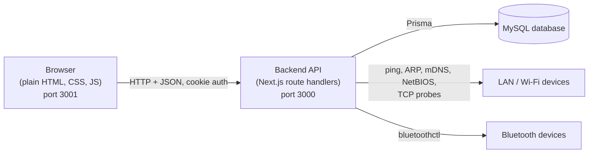
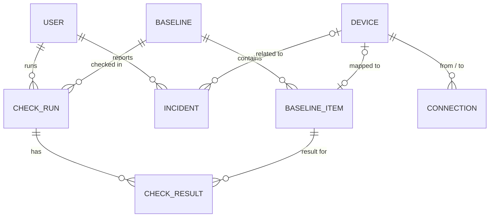

# ShowCheck: Software Requirements Specification

| | |
|---|---|
| **Product** | ShowCheck, pre-show readiness verification for live productions |
| **Document version** | 1.0 |
| **Date** | 27 October 2026 |
| **Prepared by** | Team 1, BSE Foundations Project (Viola China, Michelle Oluwayemisi Odusanwo, Nadiv Gicheru, Bertha Bemigisha Mbonimpa, Karyna Kirabo Kiwagama, Joshua Gunnogere Mulongo) |
| **Status** | MVP (school project prototype) |
| **Repository** | https://github.com/gunnogere/foundation_project_showcheck |

Each requirement has an ID, a priority (**M**ust, **S**hould, **C**ould) and a status:

- **Implemented**: built in the MVP.
- **Planned**: not built yet (future work).

---

## 1. Introduction

### 1.1 Purpose

This document specifies the functional and non-functional requirements of ShowCheck. It is written for the project team, the course supervisors, and anyone who will extend or test the system. It describes what the system does and the constraints it works under. It does not describe how to run it; see the README for that.

### 1.2 Scope

ShowCheck is a web application that helps a live-event AV crew answer one question before doors open: **does the live setup match the setup we approved for this show?**

Existing tools (Dante Controller, Q-SYS Reflect, Shure Wireless Workbench, L-Acoustics LA Network Manager, AMWA NMOS, AVIXA verification) report whether equipment is online or reachable. Each is limited to one vendor ecosystem or is a standard rather than an application. ShowCheck combines discovery, a saved approved baseline, a comparison of the live setup against that baseline, and an incident log into one show-specific workflow.

**In scope (MVP):**

- Role-based login (Admin, Technical Director, Operator, Viewer).
- Device discovery on the local network (LAN / Wi-Fi) and over Bluetooth, plus manual registration of analogue devices.
- Baselines: a saved approved setup with named roles (for example "Main singer mic").
- Mapping of discovered devices to baseline roles.
- A pre-show check producing Pass, Warning, Fail or Unknown per baseline role.
- An executive dashboard with live health alerts.
- A network dependency map.
- An incident log with severity tags.

**Out of scope (MVP):**

- Reading real settings from devices over vendor protocols (Shure, Dante, NMOS, and so on).
- Scanning UHF/RF wireless signals (needs extra hardware; see section 9).
- Mobile apps, multi-venue or multi-tenant use, and cloud-hosted operation.

### 1.3 Definitions and abbreviations

| Term | Meaning |
|---|---|
| Baseline | The approved rehearsal setup for a show: a list of slots with expected settings. |
| Slot (baseline item) | One role in the show, for example "Main Singer Mic", with a device type, expected settings and a critical flag. |
| Mapping | Linking a registered device to a baseline slot. |
| Check run | One execution of the pre-show check, stored with its results. |
| Critical slot | A slot where a settings mismatch is a Fail rather than a Warning. |
| Adopt / register | Add a discovered or manual device to ShowCheck's device list. |
| Analogue device | Gear that cannot be discovered or queried (for example a passive stage monitor), registered by hand. |
| LAN / Wi-Fi | The local IP network that the backend machine is connected to. |
| RBAC | Role-based access control. |
| PJLink | A standard control protocol for projectors (TCP port 4352). |
| RTSP | Real Time Streaming Protocol, used by IP cameras (TCP port 554). |
| mDNS / NetBIOS | Name-resolution protocols used to find a device's friendly name. |
| UHF/RF | Radio frequencies used by professional wireless microphones and in-ear systems. |
| MVP | Minimum viable product. |

### 1.4 References

- ShowCheck project presentation (Team 1, October 2026).
- Project Trello board: https://trello.com/b/9jTUQosz/foundations-project-team1
- IEEE Std 830-1998, Recommended Practice for Software Requirements Specifications (structure followed loosely).
- AVIXA, AV Systems Performance Verification; AMWA NMOS specifications; Dante, Shure, L-Acoustics and Q-SYS product documentation (background on existing tools).

### 1.5 Document overview

Section 2 gives the overall description. Section 3 lists specific functional requirements. Section 4 covers the external interfaces, and section 5 the data requirements. Section 6 states non-functional requirements. Sections 7 to 9 cover constraints, known limitations and future work, and section 10 gives traceability and acceptance criteria.

---

## 2. Overall description

### 2.1 Product perspective

ShowCheck is a standalone system made of two applications:

- **Frontend:** static HTML, CSS and JavaScript served by any static file server. No build step and no Node.js needed.
- **Backend:** a Next.js application that exposes only a JSON API. It talks to a MySQL database through Prisma, and it performs the network and Bluetooth scans from the machine it runs on.

The two are separate on purpose, so frontend contributors do not need to know Node.js.

### 2.2 Product functions (summary)

1. Authenticate users and enforce role permissions.
2. Discover devices (LAN / Wi-Fi, Bluetooth) and register analogue devices by hand.
3. Create baselines, define slots, and map devices to slots.
4. Run the pre-show check and store the results.
5. Show live status on a dashboard and a network dependency map.
6. Log, filter and resolve incidents.
7. Manage users and roles (Admin).

### 2.3 User classes and characteristics

| Role | Typical person | Permissions |
|---|---|---|
| **Admin** | Production or IT lead | Everything, including managing users. |
| **Technical Director** | Lead technician | Edit baselines, manage devices and connections, run checks, log and resolve incidents. |
| **Operator** | Crew member on shift | Run checks, log incidents. Read-only elsewhere. |
| **Viewer** | Producer, client, stage manager | Read-only access to all pages. |

All users are expected to be comfortable with AV terminology and a web browser. No programming knowledge is needed to use the system.

### 2.4 Operating environment

- **Backend host:** Linux, tested on Ubuntu, with Node.js 20 or newer. Network scanning uses `ping` and `/proc/net/arp`; Bluetooth scanning uses BlueZ's `bluetoothctl` and needs a Bluetooth adapter. macOS and Windows are not tested.
- **Frontend host:** any static file server (for example `python3 -m http.server`).
- **Database:** MySQL, hosted online and shared by the team.
- **Client:** a current desktop browser. The frontend uses ES modules and the HTML `<dialog>` element. The layout is designed for desktop and is not fully responsive for small screens.
- The backend machine must be on the same network as the gear it scans.

### 2.5 Design and implementation constraints

- C-1: The frontend is plain HTML, CSS and JavaScript with no build tooling, so that team members without Node.js experience can contribute.
- C-2: The backend uses Next.js (API routes only), Prisma and MySQL.
- C-3: Database credentials live in a file that is not committed to the repository.
- C-4: The browser must open the site as `localhost` (not `127.0.0.1`) so the session cookie is sent; the backend allows cross-origin requests only from configured origins.
- C-5: Discovery of real devices depends on the interfaces and permissions those devices expose.

### 2.6 Assumptions and dependencies

- A-1: The backend machine is on the same LAN as the show equipment.
- A-2: The shared online database is reachable from the backend machine.
- A-3: Projectors, mic receivers and cameras that should be adoptable answer PJLink, Shure control or RTSP respectively.
- A-4: A rehearsal has taken place so that a correct setup can be captured as the baseline.
- A-5: Seeded demo data (mics, lights, mixer and so on) is simulated and stands in for real gear in demonstrations.

---

## 3. Functional requirements

### 3.1 Authentication and access control

| ID | Requirement | Pri | Status |
|---|---|---|---|
| FR-AUTH-1 | The system shall let a user sign in with an email address and password. | M | Implemented |
| FR-AUTH-2 | The system shall reject invalid credentials with a generic error that does not reveal whether the email exists. | M | Implemented |
| FR-AUTH-3 | The system shall keep the user signed in with an HTTP-only session cookie that expires after 8 hours. | M | Implemented |
| FR-AUTH-4 | The system shall let a user sign out, which clears the session. | M | Implemented |
| FR-AUTH-5 | The system shall store passwords only as salted hashes (bcrypt). | M | Implemented |
| FR-AUTH-6 | The system shall redirect unauthenticated users to the sign-in page, and reject unauthenticated API calls with HTTP 401. | M | Implemented |
| FR-AUTH-7 | The system shall enforce permissions on the server for every API route; hiding buttons in the interface is a convenience only. A forbidden action shall return HTTP 403. | M | Implemented |
| FR-AUTH-8 | The system shall re-read the user's role from the database on each request, so a role change takes effect immediately. | S | Implemented |

**Permission matrix** (R = read, W = write/perform):

| Capability | Admin | Technical Director | Operator | Viewer |
|---|:-:|:-:|:-:|:-:|
| View dashboard, map, baselines, devices, incidents | R | R | R | R |
| Edit baselines, slots and mappings | W | W | | |
| Register, edit and remove devices; edit connections | W | W | | |
| Run network and Bluetooth scan | W | W | | |
| Run pre-show check | W | W | W | |
| Log an incident | W | W | W | |
| Resolve or reopen an incident | W | W | | |
| Manage users and roles | W | | | |

### 3.2 User management

| ID | Requirement | Pri | Status |
|---|---|---|---|
| FR-USR-1 | An Admin shall be able to list all users with their role. | M | Implemented |
| FR-USR-2 | An Admin shall be able to create a user with a name, unique email, password of at least 8 characters, and a role. | M | Implemented |
| FR-USR-3 | An Admin shall be able to change another user's role. | M | Implemented |
| FR-USR-4 | The system shall prevent an Admin from changing their own role. | S | Implemented |
| FR-USR-5 | The system shall reject creating a user with an email that is already registered (HTTP 409). | M | Implemented |
| FR-USR-6 | A user shall be able to change their own password. | C | Planned |
| FR-USR-7 | An Admin shall be able to deactivate or delete a user. | C | Planned |

### 3.3 Device discovery and registration

| ID | Requirement | Pri | Status |
|---|---|---|---|
| FR-DISC-1 | Authorised users shall be able to start a scan from a "Register devices" dialog. | M | Implemented |
| FR-DISC-2 | A scan shall run the LAN / Wi-Fi scan and the Bluetooth scan at the same time and return one combined result list. | M | Implemented |
| FR-DISC-3 | The LAN / Wi-Fi scan shall ping every address of the backend machine's local /24 subnet and list each host that answers. | M | Implemented |
| FR-DISC-4 | For each LAN host the system shall record its IP address and, where available, its MAC address (from the ARP table). | M | Implemented |
| FR-DISC-5 | For each LAN host the system shall try to resolve a friendly name (for example "Jeremiahs-iPhone", "DESKTOP-PC") using mDNS, NetBIOS and reverse DNS, and shall ignore answers that are only an IP address. Hosts without a name shall be shown as "Unknown device". | S | Implemented |
| FR-DISC-6 | The system shall classify a LAN host as adoptable only if it answers a supported protocol: PJLink (TCP 4352, projector), Shure control (TCP 2202, microphone receiver) or RTSP (TCP 554, camera). | M | Implemented |
| FR-DISC-7 | Any LAN host that answers none of those protocols (laptops, phones and so on) shall be shown as **Not adoptable**. The computer running ShowCheck shall be labelled "this computer" and not adoptable. | M | Implemented |
| FR-DISC-8 | The Bluetooth scan shall listen for nearby devices for about 8 seconds and record each device's MAC address, name, device class or icon, and signal strength where reported. | M | Implemented |
| FR-DISC-9 | The system shall classify Bluetooth audio gear (headsets, headphones, speakers, including silent disco headsets) as adoptable, and all other Bluetooth devices as not adoptable. | M | Implemented |
| FR-DISC-10 | If Bluetooth tools or an adapter are unavailable, the scan shall still return the LAN results and report that Bluetooth is unavailable, with the reason. | S | Implemented |
| FR-DISC-11 | Each scan result shall show an icon (phone, tablet, laptop, desktop, headset, speaker, or device-type icon) when the kind can be determined, and no icon when it cannot. | S | Implemented |
| FR-DISC-12 | Each result shall show where it was found: **Bluetooth** or **LAN / Wi-Fi**. | M | Implemented |
| FR-DISC-13 | The result list shall have filters: All, Bluetooth, Network (LAN / Wi-Fi) and RF Receiver, each with a result count. The RF Receiver filter shall be shown as not available and explain that it is future work. | M | Implemented |
| FR-DISC-14 | Results shall be ordered: adoptable and new first, then already registered, then named non-adoptable hosts, then unknown hosts last. | S | Implemented |
| FR-DISC-15 | While a scan runs, the interface shall show moving progress dots and the list placeholder, and shall disable the Scan button. | S | Implemented |
| FR-DISC-16 | The user shall be able to tick one or more adoptable results and register them in one action. Selections shall persist when the filter changes. Already registered devices shall not be selectable. | M | Implemented |
| FR-DISC-17 | A user shall be able to register an **analogue device** manually by giving a name, type, optional manufacturer and model, and optional key=value settings. | M | Implemented |
| FR-DISC-18 | Analogue devices shall be marked as such and shall never be verified automatically. | M | Implemented |
| FR-DISC-19 | The scan shall only cover the backend machine's own local subnet. | M | Implemented |
| FR-DISC-20 | The system shall scan UHF/RF wireless signals with an RF receiver or SDR dongle to detect wireless mics and in-ear systems and check their frequencies. | C | Planned |
| FR-DISC-21 | The system shall read device settings directly through vendor protocols (for example Shure, Dante, NMOS) when adopting a device. | S | Planned |

### 3.4 Device management

| ID | Requirement | Pri | Status |
|---|---|---|---|
| FR-DEV-1 | The system shall list all registered devices with name, type, manufacturer and model, source (LAN / Wi-Fi, Bluetooth or Analogue), address and MAC, online state, and the baseline slot it is mapped to. | M | Implemented |
| FR-DEV-2 | Each device shall show an icon based on its type or kind. | S | Implemented |
| FR-DEV-3 | The list shall refresh automatically every 5 seconds. | S | Implemented |
| FR-DEV-4 | An Admin or Technical Director shall be able to edit a device's online state and live settings (used to simulate faults in demonstrations and to correct data). | M | Implemented |
| FR-DEV-5 | An Admin or Technical Director shall be able to remove a device. Removing a device shall unmap it from its baseline slot and delete its connections. | M | Implemented |
| FR-DEV-6 | A device identifier shall be unique; registering the same device twice shall be rejected (HTTP 409). | M | Implemented |
| FR-DEV-7 | The system shall automatically update a registered device's online state and settings from the network. | S | Planned |

### 3.5 Baselines and mapping

| ID | Requirement | Pri | Status |
|---|---|---|---|
| FR-BASE-1 | An Admin or Technical Director shall be able to create a baseline with a name, optional venue and optional event date. | M | Implemented |
| FR-BASE-2 | When creating a baseline, the user shall be able to capture a snapshot of every registered device's current settings. Each device becomes a slot with those settings as the expected values, mapped to that device. | M | Implemented |
| FR-BASE-3 | A user shall be able to add, edit and remove slots. A slot has a role label, a device type, expected settings (key=value), a critical flag, and an optional mapped device. | M | Implemented |
| FR-BASE-4 | A user shall be able to map a slot to a device, or unmap it, from the slot table. | M | Implemented |
| FR-BASE-5 | When mapping a device to an existing slot, the system shall only allow a device of the same type (HTTP 400 otherwise). The slot dialog and slot table only offer devices of the matching type. | M | Implemented |
| FR-BASE-6 | A device shall be mapped to at most one slot; mapping an already-mapped device shall be rejected (HTTP 409) with the name of the slot using it. | M | Implemented |
| FR-BASE-7 | A user shall be able to "recapture" a slot, copying the mapped device's current settings into the baseline's expected values. | S | Implemented |
| FR-BASE-8 | Only one baseline shall be active at a time. Activating a baseline shall deactivate the others. | M | Implemented |
| FR-BASE-9 | A user shall be able to delete a baseline, which also deletes its slots and check history. | S | Implemented |
| FR-BASE-10 | The baseline page shall show, for each slot, the expected settings alongside the live settings, with differing values highlighted and showing the live value. | M | Implemented |
| FR-BASE-11 | Mapping shall support the use case "Mic 1 is the main singer, Mic 2 is backup artist A": the check compares the device in the role, not just any device of that type. | M | Implemented |
| FR-BASE-12 | A baseline shall be versioned, with a history of changes and who made them. | C | Planned |

### 3.6 Pre-show check

| ID | Requirement | Pri | Status |
|---|---|---|---|
| FR-CHK-1 | An Admin, Technical Director or Operator shall be able to run a pre-show check against the active baseline. If no baseline is active, the system shall refuse with a clear message (HTTP 400). | M | Implemented |
| FR-CHK-2 | The check shall give every slot exactly one status, using the rules in the table below. | M | Implemented |
| FR-CHK-3 | The system shall store each run with who ran it, when, per-slot statuses and details, and the counts of Pass, Warning, Fail and Unknown. | M | Implemented |
| FR-CHK-4 | The baseline page shall show a history of recent check runs. | S | Implemented |
| FR-CHK-5 | For each slot with a Fail, the check shall create a Critical incident, unless an open incident with the same title already exists. | S | Implemented |
| FR-CHK-6 | "Pass" shall apply only to the properties that were checked, not to the whole production. The interface wording shall not claim more than this. | M | Implemented |
| FR-CHK-7 | The system shall compare setting values as text, so "48 kHz" and 48000 are treated as different. | M | Implemented (limitation) |

**Status rules** (evaluated in this order, first match wins):

| # | Condition | Status | Detail shown |
|---|---|---|---|
| 1 | No device is mapped to the slot | Unknown | "No device mapped to this baseline slot" |
| 2 | The device is offline | Fail | "Device is not responding" |
| 3 | The device is an analogue (manual) device | Unknown | "Analogue device - cannot be verified automatically" |
| 4 | At least one expected setting differs from the live value, and the slot is critical | Fail | Each difference: "key: expected X, found Y" |
| 5 | At least one expected setting differs, and the slot is not critical | Warning | Each difference |
| 6 | All expected settings match | Pass | "Matches baseline" |

### 3.7 Executive dashboard

| ID | Requirement | Pri | Status |
|---|---|---|---|
| FR-DASH-1 | The dashboard shall show the active baseline's name and venue, or a prompt to set one up. | M | Implemented |
| FR-DASH-2 | It shall show the number of slots in each status (Pass, Warning, Fail, Unknown). | M | Implemented |
| FR-DASH-3 | It shall show a banner stating whether everything matches or how many items need attention, coloured by the worst status. | M | Implemented |
| FR-DASH-4 | It shall list health alerts: every slot that is not Pass, with the reason. | M | Implemented |
| FR-DASH-5 | It shall list the most recent open incidents with their severity. | M | Implemented |
| FR-DASH-6 | It shall show a table of all slots with device, type, status and details. | M | Implemented |
| FR-DASH-7 | It shall show who ran the last check and when. | S | Implemented |
| FR-DASH-8 | The dashboard shall evaluate the live device state on each refresh and update automatically every 5 seconds without a page reload. | M | Implemented |
| FR-DASH-9 | Authorised users shall be able to run the check from the dashboard. | S | Implemented |
| FR-DASH-10 | The dashboard shall push updates instantly (WebSocket or server-sent events) instead of polling. | C | Planned |
| FR-DASH-11 | The dashboard shall give an audible or on-screen alarm when a status changes to Fail. | C | Planned |

### 3.8 Network dependency map

| ID | Requirement | Pri | Status |
|---|---|---|---|
| FR-MAP-1 | The map shall draw every registered device as a node and every connection as a directed line. | M | Implemented |
| FR-MAP-2 | Nodes shall be arranged left to right by signal flow (sources, network, audio hub, outputs). | S | Implemented |
| FR-MAP-3 | A node's colour shall reflect its live check status; devices not in the active baseline shall be shown with a dashed grey outline and labelled "not in baseline". | M | Implemented |
| FR-MAP-4 | Selecting a node shall show its status and reason, type, online state, IP address and settings. | M | Implemented |
| FR-MAP-5 | Selecting a connection shall show its endpoints and label. | S | Implemented |
| FR-MAP-6 | An Admin or Technical Director shall be able to add a connection between two devices, with an optional label, and remove a connection. Self-connections and duplicates shall be rejected. | M | Implemented |
| FR-MAP-7 | The map shall refresh every 5 seconds. | S | Implemented |
| FR-MAP-8 | The system shall discover connections between devices automatically (for example from LLDP or switch port tables). | C | Planned |

### 3.9 Incident logging

| ID | Requirement | Pri | Status |
|---|---|---|---|
| FR-INC-1 | An Admin, Technical Director or Operator shall be able to log an incident with a title, severity (**Info**, **Warning** or **Critical**), optional notes and an optional related device. | M | Implemented |
| FR-INC-2 | The system shall record who reported each incident and when. | M | Implemented |
| FR-INC-3 | The incident list shall show severity tags, title, notes, device, reporter, time and state, with open incidents listed before resolved ones. | M | Implemented |
| FR-INC-4 | The list shall be filterable between Open and All. | S | Implemented |
| FR-INC-5 | An Admin or Technical Director shall be able to resolve and reopen an incident; resolving shall record the time. | M | Implemented |
| FR-INC-6 | Failing checks shall create incidents automatically (see FR-CHK-5). | S | Implemented |
| FR-INC-7 | The system shall record availability changes during the show as incidents automatically, without needing a check to be run. | C | Planned |
| FR-INC-8 | Incidents shall be exportable (CSV or PDF) for later investigation. | C | Planned |

---

## 4. External interface requirements

### 4.1 User interface

- UI-1: Seven pages: Sign in, Dashboard, Network Map, Baseline & Check, Devices, Incidents, and Users (Admin only, hidden from other roles).
- UI-2: A persistent sidebar with navigation, the signed-in user's name and role, and a sign-out button.
- UI-3: A dark theme with high-contrast text. Status is conveyed by colour and by text label (PASS, WARNING, FAIL, UNKNOWN), never by colour alone.
- UI-4: Status colours are consistent across pages: green for Pass, amber for Warning, red for Fail, grey for Unknown. Severity uses blue (Info), amber (Warning) and red (Critical).
- UI-5: Forms and registration use modal dialogs. Success and error messages appear as short toast notifications.
- UI-6: Destructive actions (removing a device, deleting a baseline, removing a connection) ask for confirmation.
- UI-7: All user-supplied and device-supplied text (device names, incident notes, Bluetooth names) is escaped before display.

### 4.2 Hardware interfaces

- HI-1: Network interface of the backend machine, for ICMP ping, TCP probes, UDP name queries and ARP table reading.
- HI-2: Bluetooth adapter, accessed through BlueZ.
- HI-3 (planned): RF receiver or SDR dongle for UHF scanning.

### 4.3 Software interfaces

- SI-1: MySQL database through Prisma.
- SI-2: Linux `ping`, `/proc/net/arp` and `bluetoothctl`.
- SI-3: Network protocols used for probing: PJLink (TCP 4352), Shure control (TCP 2202), RTSP (TCP 554), mDNS (UDP 5353), NetBIOS name service (UDP 137), reverse DNS.

### 4.4 Backend HTTP API

All endpoints are under `/api`, exchange JSON, and (except login) require the session cookie. Errors return `{ "error": "message" }` with an appropriate status (400 invalid input, 401 not signed in, 403 role not allowed, 404 not found, 409 conflict).

| Method and path | Purpose | Allowed roles |
|---|---|---|
| POST `/auth/login` | Sign in, set session cookie | Anyone |
| POST `/auth/logout` | Sign out | Anyone |
| GET `/auth/me` | Current user | Any signed-in user |
| GET `/users`, POST `/users` | List or create users | Admin |
| PATCH `/users/:id` | Change a role | Admin |
| GET `/devices` | List devices | Any signed-in user |
| POST `/devices` | Register a device | Admin, Technical Director |
| PATCH `/devices/:id`, DELETE `/devices/:id` | Edit or remove a device | Admin, Technical Director |
| POST `/discovery/scan` | Run LAN / Wi-Fi and Bluetooth scan | Admin, Technical Director |
| GET `/connections` | List connections | Any signed-in user |
| POST `/connections`, DELETE `/connections/:id` | Add or remove a connection | Admin, Technical Director |
| GET `/baselines` | List baselines with slots and devices | Any signed-in user |
| POST `/baselines` | Create a baseline (optionally from live devices) | Admin, Technical Director |
| PATCH `/baselines/:id`, DELETE `/baselines/:id` | Edit, activate or delete a baseline | Admin, Technical Director |
| POST `/baselines/:id/items` | Add a slot | Admin, Technical Director |
| PATCH `/baselines/:id/items/:itemId`, DELETE | Edit, map, recapture or remove a slot | Admin, Technical Director |
| GET `/checks`, GET `/checks/:id` | Check history, one run's details | Any signed-in user |
| POST `/checks` | Run the pre-show check | Admin, Technical Director, Operator |
| GET `/dashboard` | Live status of the active baseline, open incidents, last check | Any signed-in user |
| GET `/incidents` | List incidents | Any signed-in user |
| POST `/incidents` | Log an incident | Admin, Technical Director, Operator |
| PATCH `/incidents/:id` | Resolve or reopen | Admin, Technical Director |

---

## 5. Data requirements

### 5.1 Logical data model

### 5.2 Entities

| Entity | Key fields | Notes |
|---|---|---|
| **User** | id, name, email (unique), passwordHash, role, createdAt | Role is Admin, Technical Director, Operator or Viewer. |
| **Device** | id, name, type, source (discovered or manual), identifier (unique), manufacturer, model, ipAddress, online, params (JSON), lastSeen | Type is Camera, Light, Microphone, Switch, Mixer, Projector, Playback or Other. Bluetooth and LAN details such as MAC address and kind are kept in `params`. |
| **Baseline** | id, name, venue, eventDate, active, createdAt | At most one active. |
| **BaselineItem** (slot) | id, baselineId, label, type, expectedParams (JSON), critical, deviceId (unique, nullable) | The unique device link enforces one device per slot. |
| **Connection** | id, fromDeviceId, toDeviceId, label | Unique per ordered pair of devices. |
| **CheckRun** | id, baselineId, runById, createdAt, pass, warning, fail, unknown | Counts are stored for fast history display. |
| **CheckResult** | id, runId, itemId, status, details | One row per slot per run. |
| **Incident** | id, title, description, severity, resolved, deviceId (nullable), reportedById, createdAt, resolvedAt | Severity is Info, Warning or Critical. |

### 5.3 Data retention and integrity

- DR-1: Deleting a baseline deletes its slots, results and check runs. Deleting a device unmaps its slot (the slot remains) and removes its connections; incidents referencing it keep the incident but lose the device link.
- DR-2: Passwords are never stored or returned in plain text.
- DR-3: The seed data (four demo users, a demo show, simulated devices) is for development and demonstration only.

---

## 6. Non-functional requirements

### 6.1 Performance

| ID | Requirement | Status |
|---|---|---|
| NFR-PERF-1 | Pages shall load their data and become usable within 3 seconds on a normal LAN connection to the backend and database. | Target |
| NFR-PERF-2 | The combined LAN and Bluetooth scan shall complete within 20 seconds on a /24 network (measured at about 11 to 14 seconds). | Implemented |
| NFR-PERF-3 | Dashboard, map, device and incident views shall reflect changes within 10 seconds (5-second polling plus request time). | Implemented |
| NFR-PERF-4 | The pre-show check shall complete within 5 seconds for a baseline of up to 50 slots. | Target |

### 6.2 Security

| ID | Requirement | Status |
|---|---|---|
| NFR-SEC-1 | Every API route except login shall verify the session and the role on the server. | Implemented |
| NFR-SEC-2 | Session tokens shall be signed (HS256) and delivered in an HTTP-only cookie; secure flag set in production. | Implemented |
| NFR-SEC-3 | Passwords shall be hashed with bcrypt. | Implemented |
| NFR-SEC-4 | All request bodies shall be validated on the server (schema validation), returning HTTP 400 for invalid input. | Implemented |
| NFR-SEC-5 | Database access shall go through a parameterised ORM (no string-built SQL). | Implemented |
| NFR-SEC-6 | Cross-origin access shall be limited to configured frontend origins. | Implemented |
| NFR-SEC-7 | Output shall be escaped in the browser to prevent injection from device-supplied names (a nearby Bluetooth device could advertise any name). | Implemented |
| NFR-SEC-8 | Database credentials and the signing secret shall be kept out of the repository. | Implemented |
| NFR-SEC-9 | The scan shall be limited to the machine's own subnet and to users with device-management rights. | Implemented |
| NFR-SEC-10 | Demo accounts use a well-known default password; these shall be changed or removed before any real use. | Known limitation |
| NFR-SEC-11 | Database SSL certificates shall be verified strictly (currently set to accept any certificate for the hosted database). | Planned |
| NFR-SEC-12 | The system shall rate-limit sign-in attempts and keep an audit log of administrative actions. | Planned |

### 6.3 Reliability and availability

- NFR-REL-1: If the Bluetooth scan fails or is unavailable, the LAN scan results shall still be returned (implemented).
- NFR-REL-2: A failed API call shall show an error message to the user and shall not break the page (implemented).
- NFR-REL-3: The system is designed to be run locally at the venue, so a show does not depend on an internet connection except for reaching the hosted database. A fully offline mode with a local database is planned.

### 6.4 Usability

- NFR-USE-1: A first-time user with AV knowledge shall be able to find and run a pre-show check within 5 minutes without training (target, to be measured in the pilot).
- NFR-USE-2: Pages shall use plain wording ("Not adoptable", "Matches baseline") and give a reason whenever a status is not Pass.
- NFR-USE-3: Progress feedback shall be shown for any operation longer than 1 second (moving dots during scans).
- NFR-USE-4: Text and status colours shall have sufficient contrast on the dark background; motion shall be reduced for users who request it.

### 6.5 Portability and compatibility

- NFR-PORT-1: Backend tested on Ubuntu Linux with Node.js 20 or newer. Network and Bluetooth scanning are Linux-specific.
- NFR-PORT-2: The frontend runs on any static server and any current desktop browser supporting ES modules.

### 6.6 Maintainability and extensibility

- NFR-MAINT-1: Frontend and backend are separate folders with a documented API, so they can be developed independently.
- NFR-MAINT-2: Each scanner is an isolated module (`network-scan.ts`, `bluetooth-scan.ts`) so new discovery methods (including an RF scanner) can be added without changing the rest of the app.
- NFR-MAINT-3: Permission rules live in one backend file and the status rules in one function, so they can be changed in one place.
- NFR-MAINT-4: The database schema is defined in one Prisma schema file.

### 6.7 Quality targets from the project plan

These are evaluation goals from the project presentation. **No test or pilot results are claimed.**

| Target | Measure |
|---|---|
| At least 95% of planted faults detected | In observed trials, planted faults (wrong input, changed setting, offline device) are reported as Warning or Fail. |
| 0 false-ready results | The system never shows all-Pass when a planted fault exists. |
| At least 50% reduction in verification time | Compared with manual verification by the crew. |
| Pilot | 5 or more crew members, 1 live event, Kigali. |

---

## 7. Use cases

### UC-1: Prepare a baseline (Admin / Technical Director)

1. Register the rehearsal gear (scan, or manual for analogue gear).
2. Open Baseline & Check and choose **New baseline**, ticking "capture current settings".
3. Rename slots to roles (for example "Main Singer Mic") and set which are critical.
4. Map devices to slots where the automatic mapping is not right.
5. Set the baseline **active**.

*Result:* the approved setup is saved and becomes the reference for all checks.

### UC-2: Run the pre-show check (Operator or higher)

1. Open the Dashboard or Baseline & Check and press **Run pre-show check**.
2. The system compares each slot's expected settings to the live device state.
3. The result is stored and shown; any Fail creates a Critical incident.
4. The crew reviews the alerts, fixes the equipment, and runs the check again.

*Result:* the crew knows what matches, what changed and what needs checking.

### UC-3: Discover and adopt devices (Admin / Technical Director)

1. Open Devices, press **Register devices**, then **Scan network**.
2. Wait while progress dots show; review results with icons, names, MAC addresses and the Bluetooth or LAN / Wi-Fi badge.
3. Use the filters to narrow the list; tick adoptable devices and register them.
4. Devices shown as Not adoptable (laptops, phones, unknown hosts) cannot be selected.

### UC-4: Monitor during the show (any role)

1. Keep the Dashboard open; it refreshes every 5 seconds.
2. When a device goes offline or a setting drifts, its slot turns Warning or Fail and appears under Health alerts.
3. An Operator logs an incident describing what happened; a Technical Director resolves it later.

### UC-5: Review the dependency map (any role)

1. Open Network Map to see how gear is connected (playback, switch, mixer, outputs).
2. Click a red node to see why it failed and which downstream devices depend on it.
3. A Technical Director adds or removes connections to match the real cabling.

---

## 8. Known limitations (MVP)

1. **Settings are not read from adopted devices.** Adopting a device stores the information from the scan (name, address, MAC). Expected and live settings are compared from stored values, so changes made on the physical device are not seen unless a user edits the stored settings. Reading real settings needs vendor-protocol adapters (see FR-DISC-21).
2. **Bluetooth devices cannot be re-verified.** Their online state is not refreshed, so a baseline check on an adopted Bluetooth headset reports Pass even if it has been switched off. Showing Unknown for these is a recommended change.
3. **UHF/RF wireless gear is not scanned.** A laptop's Wi-Fi and Bluetooth adapters cannot tune to UHF/VHF. Wireless mics are detected only if their receiver is on the network.
4. **Demo gear is simulated.** The mics, lights, mixer and other devices in the seeded show are stored data, not live hardware.
5. **Name and MAC accuracy varies.** Many devices do not answer name queries and appear as "Unknown device". Phones using MAC randomisation show a different MAC per network.
6. **Linux only for scanning.** The scan depends on `ping`, `/proc/net/arp` and BlueZ.
7. **Polling, not push.** Updates can take up to 5 seconds to appear.
8. **Value comparison is textual**, so differently formatted but equal values are reported as differences.
9. **Shared database.** The team shares one online database, so test data and schema changes affect everyone.
10. **Weak defaults for demonstration.** Demo accounts share a default password; the hosted database connection does not verify the SSL certificate.

---

## 9. Future work

| Item | Description |
|---|---|
| **RF receiver** | Add an RF receiver or SDR dongle (for example RTL-SDR) connected to the backend to scan UHF/VHF. Check that each microphone's baseline frequency is transmitting and flag interference or a wrong frequency. It would be a new scanner module feeding the same Register devices dialog and the RF Receiver filter. A spectrum scan shows that a signal exists, not which device it is, so identity and settings would still come from the receiver's network interface. |
| **Vendor protocol adapters** | Read real settings from Shure receivers, Dante devices, NMOS nodes, PJLink projectors, ONVIF/RTSP cameras, Art-Net/sACN lighting and OSC mixers. |
| **Live presence** | Continually update online state from the network and Bluetooth, and raise incidents automatically on availability changes. |
| **Push updates** | WebSocket or server-sent events for instant dashboard changes and alarms. |
| **Offline mode** | Local database option so the system runs with no internet at the venue. |
| **Baseline versioning and approval** | History of changes, sign-off by the Technical Director, and comparison between shows. |
| **Reporting** | Export check results and incidents to PDF or CSV. |
| **Security hardening** | Strict SSL, password change, sign-in rate limiting, audit log, account deactivation. |
| **Other platforms** | Windows and macOS support for scanning; responsive layout for tablets. |
| **Automatic topology** | Discover connections between devices (LLDP, switch port tables). |

---

## 10. Traceability and acceptance

### 10.1 Traceability to project goals

| Project goal (from the plan) | Requirements |
|---|---|
| Discover: find supported devices, add manual items | FR-DISC-1 to FR-DISC-19, FR-DEV-1 to FR-DEV-6 |
| Baseline: save the approved rehearsal setup | FR-BASE-1 to FR-BASE-11 |
| Check: compare the live setup with the baseline | FR-CHK-1 to FR-CHK-7 |
| Report: show status and record incidents | FR-DASH-1 to FR-DASH-9, FR-MAP-1 to FR-MAP-7, FR-INC-1 to FR-INC-6 |
| Role-based crew workflow | FR-AUTH-1 to FR-AUTH-8, FR-USR-1 to FR-USR-5 |
| Clear results: Pass, Warning, Fail, Unknown | FR-CHK-2, status rules table, UI-3, UI-4 |
| Local and offline-friendly, low hardware cost | C-1, NFR-REL-3, NFR-MAINT-2 |

### 10.2 Acceptance criteria (MVP demonstration)

The MVP is accepted when, using the seeded demo data and a Technical Director account:

1. The Dashboard shows 7 Pass, 1 Warning (projector input), 1 Fail (offline LED bar) and 1 Unknown (analogue stage monitor), with matching health alerts.
2. Editing the projector's live input back to the baseline value, then running a check, changes it to Pass and the Warning disappears.
3. Taking a device offline and running a check creates a Critical incident that appears on the Incidents page, and running the check again does not duplicate it.
4. A Viewer cannot see Run check, Register devices or Log incident controls, and direct API calls for those actions return HTTP 403.
5. An Operator can run a check and log an incident but cannot edit a baseline or register a device.
6. Mapping a microphone to a camera slot is rejected, and mapping one device to two slots is rejected.
7. A scan returns LAN / Wi-Fi hosts and Bluetooth devices with names (where available), MAC addresses and a source badge; laptops and phones appear as Not adoptable; the Bluetooth, Network and RF Receiver filters behave as specified.
8. An Admin can create a user and change another user's role; an Admin cannot change their own role.
9. Signing out and opening a page redirects to the sign-in page.

---

## 11. Revision history

| Version | Date | Author | Change |
|---|---|---|---|
| 1.0 | 27 October 2026 | Team 1 | First full specification of the MVP. |
